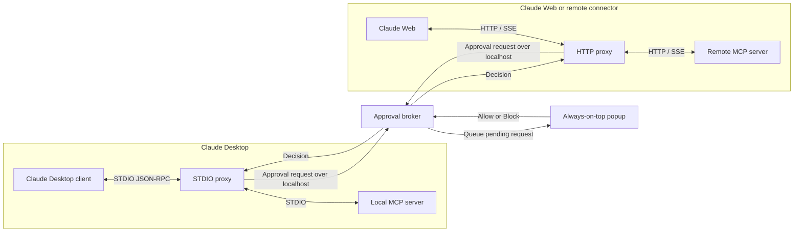

# Architecture & Interception Design

## 1. Why Dual-Transport Interception Is Required

Claude Desktop and Claude Web use two distinct MCP transport models:

1. **Claude Desktop (Local MCP Servers)** spawns local child processes and communicates over **STDIO** using newline-delimited JSON-RPC 2.0 messages (`stdin` / `stdout`).
2. **Claude Web & Claude Desktop Custom Connectors (Remote MCP Servers)** communicate over **Streamable HTTP** (`POST` JSON-RPC requests, optional `text/event-stream` SSE responses) or legacy **SSE** (`GET /sse` + `POST /messages`). Crucially, for **Claude Web**, MCP requests originate from Anthropic's cloud infrastructure toward the registered connector URL—not directly from the user's browser—so a local HTTP/SSE reverse proxy paired with a tunnel (or a gateway in front of the MCP server) is the most reliable, TLS-clean interception point.

MCP Gatekeeper handles both transports uniformly by decoupling **transport proxies** from a **central Approval Broker and UI**.

---

## 2. System Topology

The diagram below shows the two supported transport paths and the shared approval flow. Claude Desktop's local STDIO servers are wrapped directly; remote MCP traffic must be routed through the HTTP proxy.



For an intercepted tool call, the proxy waits for the broker's decision. Allow forwards the original request to the MCP server; Block returns a JSON-RPC error to Claude without calling the server.

```
+-------------------+        STDIO         +-------------------+
|  Claude Desktop   | <==================> |   StdioMCPProxy   | ---> Local MCP Server
+-------------------+                      +-------------------+
                                                     |
                                                     | TCP JSON-Lines (127.0.0.1:8765)
                                                     v
+-------------------+   HTTP / SSE (POST)  +-------------------+      +------------------------+
|    Claude Web     | <==================> |   HttpMCPProxy    | ---> | ApprovalBrokerServer   |
| (Custom Connector)|                      +-------------------+      |  + Pending Futures     |
+-------------------+                                |                |  + GatekeeperTkUI      |
                                                     v                +------------------------+
                                           Upstream Remote MCP
```

---

## 3. Core Components

| Module | Responsibility |
| :--- | :--- |
| `protocol.py` | Parses JSON-RPC 2.0 payloads, isolates gated methods (`tools/call` by default; `resources/read` and `prompts/get` in `--strict` mode), lets handshake/discovery (`initialize`, `tools/list`, notifications) pass through immediately, and builds compliant `-32001` error responses on denial. |
| `broker.py` | Runs an `asyncio` TCP JSON-lines server (`ApprovalBrokerServer`). Assigns each intercepted request a UUID `approval_id` and parks it on an `asyncio.Future`. Multiple proxies submit requests concurrently without blocking each other. |
| `stdio_proxy.py` | Spawns the wrapped MCP server subprocess and runs three concurrent `asyncio` pumps (`stdin`, `stdout`, `stderr`). Gated requests are dispatched as independent `asyncio.Task`s so multiple simultaneous tool calls are awaited concurrently; writes to child `stdin` and parent `stdout` are protected by `asyncio.Lock`s to prevent line interleaving. |
| `http_proxy.py` | Async reverse proxy supporting `Content-Length` and `Transfer-Encoding: chunked` `POST` bodies, JSON-RPC single objects and batches, and `text/event-stream` SSE streaming responses. |
| `ui.py` | Runs `tkinter` on the main thread with `-topmost` enabled, polling a thread-safe `queue.Queue` fed by the background `asyncio` broker thread. Supports `Pending 1 of N` queue navigation so simultaneous requests never overwrite or drop each other. |
| `config_manager.py` | Safely backs up `claude_desktop_config.json` and wraps/unwraps `mcpServers` entries idempotently. |

---

## 4. Request Lifecycle & Concurrency

1. **Detection**: A proxy reads a JSON-RPC message and calls `extract_intercepted_request()`. Non-gated methods (`initialize`, `tools/list`, notifications) are forwarded immediately.
2. **Hold**: For gated requests (`tools/call`), the proxy spawns an async task (in STDIO) or awaits inside the connection handler (in HTTP) and calls `BrokerClient.request_approval()`.
3. **User Decision**: The central broker enqueues a `PendingApproval` into the UI thread and suspends on an `asyncio.Future`. The popup appears on top of all windows.
4. **Release or Deny**:
   - **Allow**: The broker resolves the `Future` with `allowed=True`; the proxy writes the original payload to the upstream MCP server and relays the real response back to Claude.
   - **Block**: The broker resolves the `Future` with `allowed=False`; the proxy never contacts the upstream server and immediately returns a JSON-RPC 2.0 error (`code: -32001`) to Claude.
5. **Failure Modes**: If the broker is unreachable, times out, or the user closes the popup window (`WM_DELETE_WINDOW`), MCP Gatekeeper **fails closed** (blocks the request) by default.
